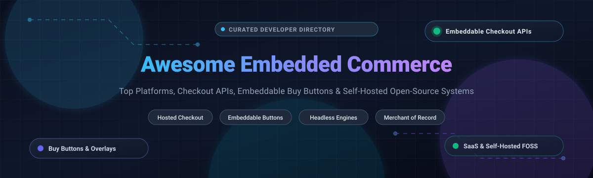

# 🛒 Awesome Embedded Commerce [](https://awesome.re)

<p align="center">
  
</p>

<p align="center">
  <strong>⚡ Curated directory of SaaS platforms, embeddable checkout APIs, buy button widgets, and self-hosted open-source commerce engines. 🚀</strong>
</p>

<p align="center">
  <a href="https://github.com/ishandutta2007/Awesome-Awesome-Awesome"></a><a href="https://discord.gg/jc4xtF58Ve"></a>
  <a href="https://github.com/ishandutta2007/Awesome-Embedded-Commerce/stargazers"></a>
  <a href="https://github.com/ishandutta2007/Awesome-Embedded-Commerce/network/members"></a>
  <a href="https://github.com/ishandutta2007/Awesome-Embedded-Commerce/blob/main/LICENSE"></a>
  <a href="https://github.com/ishandutta2007/Awesome-Awesome-Awesome"></a>
  <a href="https://github.com/ishandutta2007"></a>
</p>

---

💡 **Embedded commerce** allows creators, software developers, publishers, and digital platforms to sell physical goods, software licenses, subscriptions, and digital downloads directly within any website, mobile app, or content stream—without deploying a traditional monolithic storefront.

Whether you need a **drop-in JavaScript buy button** 🔘, a **hosted checkout link** 🔗, a **Merchant of Record (MoR)** 🌐 for global tax/VAT compliance, or a **fully self-hosted headless backend** 🛠️, this guide tracks the leading production-ready commercial solutions and open-source GitHub alternatives.

---

## 📑 Table of Contents

- [📊 Sector Overview & Market Dynamics](#-sector-overview--market-dynamics)
- [☁️ SaaS & Hosted Platforms](#️-saas--hosted-platforms)
- [💻 Open-Source GitHub Projects](#-open-source-github-projects)
  - [⚙️ Open-Source Checkout & Commerce Engines](#️-open-source-checkout--commerce-engines)
  - [📦 Open-Source Digital Product & Micro-Stores](#-open-source-digital-product--micro-stores)
  - [⚡ Crypto-Native & Decentralized Checkout](#-crypto-native--decentralized-checkout)
- [🏛️ Architectural Comparison: SaaS vs Open Source](#️-architectural-comparison-saas-vs-open-source)
- [🧭 How to Choose the Right Solution](#-how-to-choose-the-right-solution)
- [🌟 Star History](#-star-history)
- [💖 Support](#-support)
- [🤝 How to Contribute](#-how-to-contribute)
- [📄 License](#-license)

---

## 📊 Sector Overview & Market Dynamics

📈 The global embedded commerce and embedded finance market was valued at approximately **$83.4 billion in 2025** and is projected to expand past **$380 billion by 2032**, recording a compound annual growth rate (CAGR) of over **24.5%**. 

Market dynamics reflect a **moderately fragmented ecosystem transitioning toward barbell concentration**:
- 🏢 At the enterprise and hyper-scale tier, **winner-take-most infrastructure giants** like Stripe, Square (Block), and Shopify dominate underlying payment rails, checkout processing, and omnichannel APIs.
- 🌍 Concurrently, high geographic fragmentation, complex cross-border sales tax/VAT liabilities, and merchant-of-record friction have created thriving spaces for **specialized agile platforms** (e.g., Lemon Squeezy, Paddle, Snipcart, Ecwid) and indie-centric open-source engines catering to digital product developers and decentralized payments.

---

## ☁️ SaaS & Hosted Platforms

The table below catalogs premier hosted embedded commerce providers, sorted descending by enterprise scale (valuation / annual revenue).

| Platform | Pricing (Starting Tier) | Free Tier / Trial Limit | Scale (Valuation / Revenue) | Core Embedded Commerce Capabilities |
| :--- | :--- | :--- | :--- | :--- |
| **[Shopify Buy Button](https://www.shopify.com/)** | **$5/month** (Shopify Starter) + 5% transaction fee (or $39/mo Basic plan) | **3-day free trial**, followed by promotional $1/month for the first 3 months | **~$108 Billion Valuation** (Public: NYSE: SHOP; ~$8.8B ARR) | Lightweight JS snippet generating responsive buy buttons and embeddable product carts; syncs seamlessly with central Shopify order management. |
| **[Stripe Payment Links](https://stripe.com/payments/payment-links)** | **2.9% + 30¢** per successful transaction (Pay-as-you-go, no monthly base fee) | **Free forever with no time limit**; unlimited test mode and unlimited payment links created; fees incurred only on live transactions | **~$91.5 Billion Valuation** (Private tender / ~$16B+ ARR) | Instant zero-code hosted checkout URLs, QR codes, and embeddable button widgets; supports 135+ currencies, Apple Pay, Google Pay, and localized payment methods. |
| **[Square Online Checkout](https://squareup.com/)** | **2.9% + 30¢** per online transaction (Free plan) or **$29/month** Plus plan | **Free forever plan** with no monthly software fee; unlimited pay links and checkout buttons; only standard payment processing fees apply | **~$48 Billion Valuation** (Public: NYSE: SQ / Block, Inc.; ~$23.8B total gross revenue) | Embeddable payment buttons, hosted links, and QR codes for instant multi-channel selling; unifies in-person point of sale and online embedded orders. |
| **[Paddle](https://www.paddle.com/)** | **5% + 50¢** per transaction (Checkout Starter plan, no monthly recurring fee) | **Free forever sandbox & account setup**; live processing has no recurring monthly fee; pay purely per transaction with zero minimum monthly volume | **$1.4 Billion Valuation** (Unicorn status; ~$180M ARR) | Full Merchant of Record (MoR) with inline embedded modal checkout and localized SaaS subscription billing; handles global sales tax, VAT, and invoice compliance automatically. |
| **[Ecwid](https://www.ecwid.com/)** | **$19/month** Venture plan (or free basic tier) | **Free forever plan** limited to 10 physical products, 1 sales channel, and standard hosted checkout features | **$500 Million Acquisition** (Acquired by Lightspeed Commerce; Lightspeed trades on NYSE: LSPD at ~$2B+ valuation) | Universal embeddable widget injected into WordPress, Webflow, Wix, or custom HTML; complete shopping bag, localized shipping calculator, and multilingual checkout. |
| **[Lemon Squeezy](https://www.lemonsqueezy.com/)** | **5% + 50¢** per successful transaction (Free plan) or **$400/month** Enterprise | **Free forever account** with unlimited products, payment links, and hosted checkout pages; charges strictly transaction fees on processed sales | **$400 Million Acquisition** (Acquired by Stripe in 2024; operates as Stripe's premier MoR layer) | Merchant of Record platform tailored for software, SaaS, and digital downloads; provides slick embeddable checkout overlays, license key generation, and customer portals. |
| **[Gumroad](https://gumroad.com/)** | **10% flat transaction fee** + credit card processing fees (~2.9% + 30¢) | **Free forever plan** with no monthly fees; zero limits on published digital products or download storage; charges fee upon successful sale | **$100 Million+ Valuation** (Self-crowdfunded / indie valuation; ~$15M ARR) | Ultra-fast embeddable product modal overlay, pay-what-you-want pricing, tiered memberships, and immediate customer file delivery. |
| **[Snipcart](https://snipcart.com/)** | **2% transaction fee** (minimum $10/month floor if volume under $500/mo) | **Forever free test mode / 30-day unlimited staging** until store goes live into production mode | **~$35 Million Acquisition** (Acquired by Duda Inc.; Duda has raised over $100M in venture funding) | Pure developer-focused shopping cart injected via 2 lines of HTML/JS; turns any static site (Hugo, Jekyll, Astro, Next.js) into a full ecommerce checkout without backend hosting. |
| **[Payhip](https://payhip.com/)** | **5% transaction fee** (Free Forever) or **$29/month** Standard plan (2% fee) | **Free forever plan** with unlimited products, unlimited revenue, and full feature access (charges 5% transaction fee per sale) | **~$25 Million Valuation** (Bootstrapped profitable indie firm; estimated $4M ARR) | Embeddable product buttons, storefront cart overlays, automated EU/UK VAT handling, course hosting, software license keys, and affiliate partner management. |
| **[Sellfy](https://sellfy.com/)** | **$29/month** Starter plan (billed annually at $22/mo) | **14-day free trial** with full feature access and product upload capability; no credit card required during trial period | **~$15 Million Valuation** (Bootstrapped creator ecommerce platform; ~$3.5M ARR) | Embeddable buy buttons, product widgets, print-on-demand fulfillment integration, and digital downloads checkout. |

---

## 💻 Open-Source GitHub Projects

Explore battle-tested open-source repositories powering embedded checkout flows, headless ecommerce backends, digital download micro-stores, and decentralized crypto gateways.

Sorted descending by GitHub star count:

| Repository | GitHub Stars | Primary Stack | Architecture & Capabilities |
| :--- | :--- | :--- | :--- |
| **[Hyperswitch](https://github.com/juspay/hyperswitch)** | [](https://github.com/juspay/hyperswitch/stargazers) | Rust | High-performance open-source universal payments switch and embedded web/mobile checkout SDK. Connects to 50+ payment processors via a single unified API to reduce fees and boost conversion. |
| **[Medusa](https://github.com/medusajs/medusa)** | [](https://github.com/medusajs/medusa/stargazers) | TypeScript / Node.js | Modular headless commerce engine (often called the open-source Shopify alternative). Delivers rich REST/GraphQL APIs, cart primitives, multi-region currencies, and checkout modules for custom frontend embeds. |
| **[Bagisto](https://github.com/bagisto/bagisto)** | [](https://github.com/bagisto/bagisto/stargazers) | PHP / Laravel | Enterprise-grade modular commerce framework with headless REST and GraphQL APIs. Supports multi-inventory, multi-currency, and plug-and-play checkout widgets across separate web touchpoints. |
| **[Saleor](https://github.com/saleor/saleor)** | [](https://github.com/saleor/saleor/stargazers) | Python / Django / GraphQL | Modern headless GraphQL ecommerce platform built for global enterprise scale. Provides ultra-fast checkout APIs, multi-channel catalog delivery, and isolated microservice integrations. |
| **[Spree Commerce](https://github.com/spree/spree)** | [](https://github.com/spree/spree/stargazers) | Ruby on Rails | Modular headless open-source ecommerce engine. Features a complete REST/Platform API suite enabling developers to embed cart, inventory, and checkout flows into mobile apps, CMSs, and third-party pages. |
| **[WooCommerce](https://github.com/woocommerce/woocommerce)** | [](https://github.com/woocommerce/woocommerce/stargazers) | PHP / JavaScript | The world's most widely adopted open-source ecommerce core. Supports embeddable product shortcodes, headless Store API / Store REST endpoints, and decoupled checkout extensions. |
| **[Polar](https://github.com/polarsource/polar)** | [](https://github.com/polarsource/polar/stargazers) | Python / Next.js / FastAPI | Developer-focused monetization engine and Merchant of Record alternative. Built for open-source creators and SaaS developers to embed subscriptions, digital file downloads, and GitHub repository access gating. |
| **[Crater](https://github.com/crater-invoice-inc/crater)** | [](https://github.com/crater-invoice-inc/crater/stargazers) | PHP / Laravel / Vue.js | Open-source invoicing and payment management platform with client-facing checkout links and payment gateway adapters (Stripe, Razorpay, PayPal). |
| **[BTCPay Server](https://github.com/btcpayserver/btcpayserver)** | [](https://github.com/btcpayserver/btcpayserver/stargazers) | C# / .NET Core | Non-custodial, peer-to-peer cryptocurrency payment processor. Includes built-in Point of Sale, embeddable Pay Buttons (with copy-paste HTML snippets), and crowdfunding apps with zero intermediary fees. |
| **[Kill Bill](https://github.com/killbill/killbill)** | [](https://github.com/killbill/killbill/stargazers) | Java | Battle-tested open-source billing and payment orchestration platform. Designed for complex subscription models, catalog tiering, and headless integration into existing web platforms. |
| **[Solidus](https://github.com/solidusio/solidus)** | [](https://github.com/solidusio/solidus/stargazers) | Ruby on Rails | Highly customizable, scalable open-source ecommerce engine powering complex checkout and order pipelines via modular headless services. |
| **[LNbits](https://github.com/lnbits/lnbits)** | [](https://github.com/lnbits/lnbits/stargazers) | Python / FastAPI / Vue.js | Lightning Network wallet and accounts foundation. Features the **LNbits WebShop extension**, providing an iframe-embeddable checkout component for instant Bitcoin micropayments. |
| **[Stripe.js](https://github.com/stripe/stripe-js)** | [](https://github.com/stripe/stripe-js/stargazers) | JavaScript / TypeScript | Official loader and client library for Stripe Elements; the industry benchmark for embedding PCI-compliant hosted payment inputs directly within web pages. |
| **[Zoneless](https://github.com/zonelessdev/zoneless)** | [](https://github.com/zonelessdev/zoneless/stargazers) | TypeScript / Node.js | Self-hosted, Stripe-compatible API engine for stablecoins (USDC/USDT). Powers checkout sessions, embeddable payment links, and programmatic marketplace payouts without third-party escrow. |
| **[Litecart](https://github.com/shurco/litecart)** | [](https://github.com/shurco/litecart/stargazers) | Go | Single-binary shopping cart with zero external database dependencies. Supports card checkout and cryptocurrency payments, packaged for instantaneous Docker deployment. |
| **[Shopify Buy Button JS](https://github.com/Shopify/buy-button-js)** | [](https://github.com/Shopify/buy-button-js/stargazers) | JavaScript | The official lightweight client-side JavaScript library from Shopify to build customized embeddable buy buttons and carts that communicate directly with the Shopify Storefront API. |
| **[Open Payment Host](https://github.com/abishekmuthian/open-payment-host)** | [](https://github.com/abishekmuthian/open-payment-host/stargazers) | Go / Docker | Lightweight self-hosted store tailored for indie digital product creators. Features multi-country purchasing power parity (PPP) pricing, direct Stripe/Square checkout, and pre-signed AWS S3 file downloads. |
| **[Paymug](https://github.com/Paymug/paymug)** | [](https://github.com/Paymug/paymug/stargazers) | Next.js 16 / Cloudflare D1 | Self-hosted Lemon Squeezy and Polar alternative. Enables creators to sell software licenses, digital downloads, and subscriptions via PayPal and Stripe with zero platform commission. |

---

## 🏛️ Architectural Comparison: SaaS vs Open Source

```
+-----------------------------------------------------------------------------------+
|                           EMBEDDED COMMERCE ARCHITECTURE                          |
+-----------------------------------------------------------------------------------+
|                                                                                   |
|  [ Commercial SaaS Embeds ]                        [ Open-Source / Self-Hosted ]  |
|  * Shopify Buy Button / Snipcart                   * Hyperswitch, Medusa, Polar   |
|  * Stripe Payment Links / Paddle                   * BTCPay Server, Paymug, Go    |
|                                                                                   |
|   +--------------------------+                      +--------------------------+  |
|   | 1-Line Script / iframe   |                      | Headless API / Webhooks  |  |
|   | Global Tax & VAT (MoR)   |                      | Zero Revenue Commission  |  |
|   | PCI-DSS Level 1 Hosted   |                      | Complete Database Control|  |
|   | Instant Multi-Currency   |                      | Self-Managed Compliance  |  |
|   +--------------------------+                      +--------------------------+  |
|                |                                                 |                |
|                v                                                 v                |
|   [ Hosted Modal or Overlay ]                       [ Custom Component or Proxy ] |
|   Customer completes payment                        You orchestrate cart & state  |
|                                                                                   |
+-----------------------------------------------------------------------------------+
```

---

## 🧭 How to Choose the Right Solution

1. ⚡ **For zero maintenance and fastest time to market**: Choose **Stripe Payment Links** or **Shopify Buy Button**. You obtain instant cross-device checkout with one link or tag.
2. 🌍 **For selling digital goods with automated worldwide VAT handling**: Choose a **Merchant of Record** such as **Lemon Squeezy** or **Paddle**. They assume legal liability and remit sales tax on your behalf.
3. 🎨 **For static sites (SSG), Jamstack, or custom blogs**: Choose **Snipcart** or **Polar** to preserve your design freedom without spinning up databases.
4. 🔓 **For zero transaction fees and data sovereignty**: Self-host **Paymug**, **Medusa**, or **Hyperswitch** backed by your own Stripe, PayPal, or localized payment gateway account.
5. 🪙 **For Bitcoin or stablecoin payments**: Deploy **BTCPay Server**, **LNbits WebShop**, or **Zoneless** for trustless settlement.

---

## 🌟 Star History

[](https://star-history.dera.page/#ishandutta2007/Awesome-Embedded-Commerce&type=date&legend=top-left)

---

## 💖 Support

A massive **thank you** 🙏 to all developers, builders, and community supporters who use and contribute to this directory!

If you find this list helpful, please consider supporting the project:
- ⭐ **Star** this repository on GitHub to help others discover it.
- 🍴 **Fork** and share it with fellow developers and indie hackers.
- 📢 **Share** your feedback, suggest new tools, or submit a PR.
- ☕ **Buy me a coffee**: Support ongoing curation and maintenance via the [GitHub Sponsor Dashboard](https://github.com/sponsors/ishandutta2007).

---

## 🤝 How to Contribute

Contributions are welcome! Please follow these guidelines:

1. Fork this repository.
2. Ensure new SaaS additions include verifiable starting tier pricing and specific free trial terms.
3. Ensure new open-source additions include active GitHub repositories and accurate star counts.
4. Add your entry to the appropriate table and submit a Pull Request with a clear description.

---

## 📄 License

This project is licensed under the [MIT License](LICENSE).
